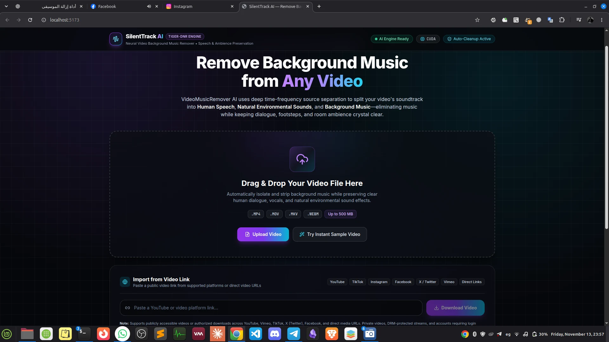

# VideoMusicRemover AI



### Remove Background Music from Videos — Keep Speech and Natural Sounds

VideoMusicRemover AI is a local AI-powered application that removes background music from videos while preserving human speech, dialogue, and environmental sounds.

Powered by the **TIGER-DnR** neural audio separation model.

- 🎙️ Preserve voices and dialogue
- 🌿 Keep natural environmental sounds
- 🎵 Separate and remove background music
- 🎬 Support MP4, MOV, MKV, and WEBM
- 🔒 Process videos locally on your computer
- ⚡ Optional NVIDIA GPU acceleration

---

## 🚀 Quick Installation

Choose your operating system and follow the instructions.

### 🪟 Windows 10 / 11

**1. Install the required software**

Open PowerShell and run:

```powershell
winget install --id Python.Python.3.12 -e
winget install --id OpenJS.NodeJS.LTS -e
winget install --id Git.Git -e
```

Close and reopen PowerShell after installation.

**2. Download the project**

```powershell
git clone https://github.com/mobadawyx4/VideoMusicRemover-AI.git
cd VideoMusicRemover-AI
```

**3. Install and launch**

```powershell
Set-ExecutionPolicy -Scope Process -ExecutionPolicy Bypass
.\install.ps1
```

That's it! The installer prepares everything and launches the application automatically.

If FFmpeg is missing, the installer can offer to install it using Winget.

### 🐧 Linux (Ubuntu / Debian / Linux Mint)

**1. Install system requirements**

```bash
sudo apt update
sudo apt install -y python3 python3-venv python3-pip nodejs npm ffmpeg git
```

**2. Download the project**

```bash
git clone https://github.com/mobadawyx4/VideoMusicRemover-AI.git
cd VideoMusicRemover-AI
```

**3. Install and launch**

```bash
chmod +x install.sh
./install.sh
```

That's it! The installer prepares the environment, downloads the AI model, checks the installation, and launches the application.

### 🌐 Open the Application

Once installation finishes, open:

**http://localhost:5173**

The application runs locally on your computer.

---

## 💻 System Requirements

| Component | Requirement |
|---|---|
| Operating System | Windows 10/11 or supported Linux distribution |
| Python | 3.10 – 3.12 |
| Node.js | 18 or newer |
| RAM | 8 GB recommended |
| Storage | Allow several GB for dependencies and processing |
| GPU | NVIDIA GPU recommended, CPU mode may be available |
| FFmpeg | Required |

Supported Linux distributions include Ubuntu, Debian, Linux Mint, Pop!_OS, Fedora, and Arch Linux.

---

## 🎬 How to Use

1. Start VideoMusicRemover AI.
2. Open the application in your browser.
3. Upload a video file.
4. Start the music removal process.
5. Wait for AI processing to finish.
6. Download your processed video.

The application separates music from speech and environmental sounds while preserving the original video.

---

## ▶️ Starting the Application Again

After the first installation, you don't need to install everything again.

**Windows:**

```powershell
.\start.ps1
```

**Linux:**

```bash
./start.sh
```

Application address:

http://localhost:5173

---

## ⏹️ Stopping the Application

**Windows:**

```powershell
.\stop.ps1
```

**Linux:**

```bash
./stop.sh
```

You can also press `Ctrl+C` in the terminal running the application.

---

## 🔄 Updating the Application

To update to the latest version:

**Windows:**

```powershell
.\update.ps1
```

**Linux:**

```bash
./update.sh
```

Your local configuration and cached AI model are preserved during normal updates.

---

## 🧠 AI Model

VideoMusicRemover AI uses **TIGER-DnR**:

[Hugging Face — JusperLee/TIGER-DnR](https://huggingface.co/JusperLee/TIGER-DnR)

The model separates audio into three components:

- Speech
- Environmental Sounds
- Music

The installer downloads and caches the model locally. Once downloaded, the cached model can be used without downloading it again.

---

## 🔧 Troubleshooting

### Python is not installed

Install Python 3.12:

```bash
# Ubuntu / Debian / Linux Mint
sudo apt install python3 python3-venv python3-pip
```

On Windows, use:

```powershell
winget install --id Python.Python.3.12 -e
```

### FFmpeg is missing

**Linux:**

```bash
sudo apt install ffmpeg
```

**Windows:**

```powershell
winget install --id Gyan.FFmpeg -e
```

Restart your terminal after installation.

### PowerShell blocks the installer

Run:

```powershell
Set-ExecutionPolicy -Scope Process -ExecutionPolicy Bypass
```

Then run:

```powershell
.\install.ps1
```

### Application does not open

Try stopping and restarting it:

```bash
# Linux
./stop.sh
./start.sh
```

On Windows:

```powershell
.\stop.ps1
.\start.ps1
```

### Ports are already in use

The application uses:

- Frontend: `5173`
- Backend: `8000`

Stop any previous application instance and try again.

---

## 🛠️ Developer Installation

If you want to run backend tests or contribute to development, install the additional development dependencies:

```bash
python -m pip install -r backend/requirements-dev.txt
```

Run tests:

```bash
python -m pytest backend/tests -q
```

---

## 🔐 Privacy

VideoMusicRemover AI is designed to run locally on your computer.

Your video processing is handled by your own machine rather than requiring you to upload videos to a remote processing service.

---

## 📜 License

See the repository for license and third-party model terms.

---

## ⭐ Support the Project

If you find VideoMusicRemover AI useful:

- Star the repository on GitHub.
- Report bugs through GitHub Issues.
- Share suggestions and improvements.

**GitHub Repository:**

https://github.com/mobadawyx4/VideoMusicRemover-AI

---

Made with ❤️ for creators.
