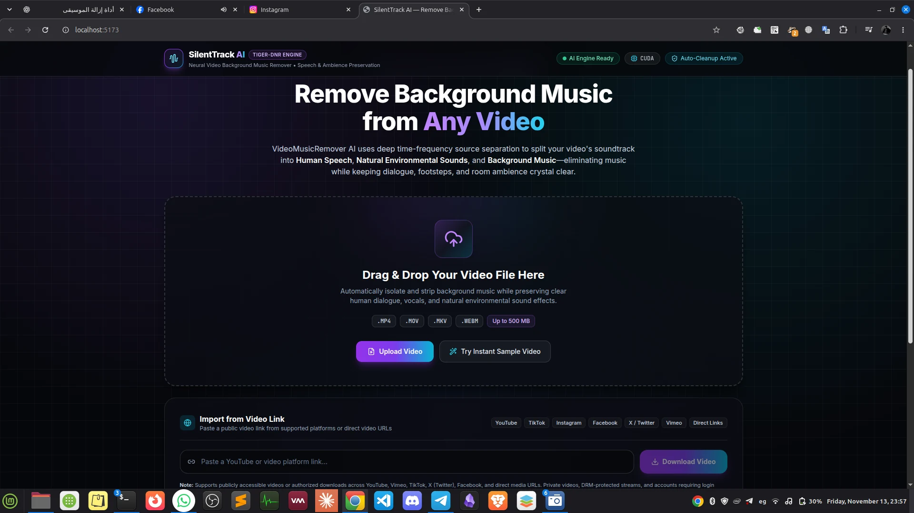

# VideoMusicRemover AI



## 🎬 Watch the Demo

[▶️ Watch the Full Demo Video](https://github.com/mobadawyx4/VideoMusicRemover-AI/raw/refs/heads/main/docs/videos/demo.mp4)

### Remove Background Music from Videos — Keep Speech and Natural Sounds

VideoMusicRemover AI is a local AI-powered application that removes background music from videos while preserving human speech, dialogue, and environmental sounds.

Powered by the **TIGER-DnR** neural audio separation model.

- 🎙️ Preserve voices and dialogue
- 🌿 Keep natural environmental sounds
- 🎵 Separate and remove background music
- 🎬 Support MP4, MOV, MKV, and WEBM
- 🔒 Process videos locally on your computer
- ⚡ Optional NVIDIA GPU acceleration

---

## 🚀 Quick Installation

Choose your operating system and follow the instructions.

### 🪟 Windows 10 / 11 (64-bit)

**1. Download the project**

```powershell
git clone https://github.com/mobadawyx4/VideoMusicRemover-AI.git
cd VideoMusicRemover-AI
```

Git is only needed to clone or update the project. You can also download the repository ZIP from GitHub.

**2. Install and launch**

```powershell
.\install.ps1
```

The installer checks Windows 10/11 x64, Python 3.10–3.12 (64-bit), Node.js LTS/npm, FFmpeg/FFprobe, and NVIDIA driver compatibility. If a prerequisite is missing and Winget is available, the installer offers to install it from the official Winget source. It then creates or reuses `.venv`, selects the compatible PyTorch 2.5.1 CPU or CUDA 12.1 build, installs verified dependencies, and launches the application.

The AI model is **not downloaded during installation**. It downloads automatically on your first video-processing run.

For unattended installation:

```powershell
.\install.ps1 -AutoInstallPrerequisites -NonInteractive -NoLaunch
```

Useful options:

| Option | Purpose |
|---|---|
| `-AutoInstallPrerequisites` | Allow Winget to install any missing supported prerequisite |
| `-AutoInstallFfmpeg` | Allow Winget to install only FFmpeg/FFprobe |
| `-NonInteractive` | Never prompt; missing prerequisites must be pre-installed or auto-install enabled |
| `-TorchMode Auto` | Default: use CUDA 12.1 when a compatible NVIDIA driver is detected, otherwise CPU |
| `-TorchMode CPU` | Force the official CPU PyTorch build |
| `-TorchMode CUDA` | Require CUDA 12.1 and fail clearly if it is unavailable |
| `-NoLaunch` | Install without starting the application |

Winget may show a Windows UAC permission prompt for some official packages. The installer never disables Windows security features and never changes the system-wide PATH.

**Manual prerequisite fallback**

If Winget is unavailable or you prefer manual installation, install 64-bit versions of:

```powershell
winget install --id Python.Python.3.12 -e
winget install --id OpenJS.NodeJS.LTS -e
winget install --id Gyan.FFmpeg -e
```

Official downloads:

- Python 3.12 (64-bit): <https://www.python.org/downloads/windows/>
- Node.js LTS: <https://nodejs.org/en/download>
- FFmpeg: <https://ffmpeg.org/download.html>

After manual installation, close and reopen PowerShell so PATH changes take effect, then run `.\install.ps1` again.

If PowerShell blocks local scripts, use the process-scoped policy below rather than disabling security permanently:

```powershell
Set-ExecutionPolicy -Scope Process -ExecutionPolicy RemoteSigned
Unblock-File .\install.ps1
.\install.ps1
```

### 🐧 Linux (Ubuntu / Debian / Linux Mint)

**1. Install system requirements**

```bash
sudo apt update
sudo apt install -y python3 python3-venv python3-pip nodejs npm ffmpeg git
```

**2. Download the project**

```bash
git clone https://github.com/mobadawyx4/VideoMusicRemover-AI.git
cd VideoMusicRemover-AI
```

**3. Install and launch**

```bash
chmod +x install.sh
./install.sh
```

That's it! The installer prepares the environment, checks the installation, and launches the application. The AI model downloads automatically on your first video-processing run.

### 🌐 Open the Application

Once installation finishes, open:

**http://localhost:5173**

The application runs locally on your computer.

---

## 💻 System Requirements

| Component | Requirement |
|---|---|
| Operating System | Windows 10/11 (64-bit x64) or supported Linux distribution |
| Python | 3.10 – 3.12, 64-bit |
| Node.js | LTS 18, 20, or 22+ with npm |
| RAM | 8 GB recommended |
| Storage | 6 GB+ recommended; the AI model needs additional free space on first use |
| GPU | Optional NVIDIA GPU with driver 527.41 or newer for CUDA 12.1 |
| CPU | Supported; no NVIDIA GPU is required |
| FFmpeg | Required, including FFprobe |

Supported Linux distributions include Ubuntu, Debian, Linux Mint, Pop!_OS, Fedora, and Arch Linux. On Windows ARM, the required PyTorch 2.5.1 wheels are not available; use an x64 Windows machine.

The installer automatically selects the official PyTorch 2.5.1 CPU build on systems without a compatible NVIDIA driver. When a compatible NVIDIA GPU and driver are detected, it installs the official CUDA 12.1 build and verifies that PyTorch can actually access the GPU. If CUDA verification fails in automatic mode, it falls back to CPU with a clear message.

---

## 🎬 How to Use

1. Start VideoMusicRemover AI.
2. Open the application in your browser.
3. Upload a video file.
4. Start the music removal process.
5. Wait for AI processing to finish.
6. Download your processed video.

The first processing run downloads the TIGER-DnR model into `data/models`. This can take several minutes depending on your connection. Later runs reuse the cache and can work offline. Keep enough free disk space available for the model.

The application separates music from speech and environmental sounds while preserving the original video.

---

## ▶️ Starting the Application Again

After the first installation, you don't need to install everything again.

**Windows:**

```powershell
.\start.ps1
```

**Linux:**

```bash
./start.sh
```

Application address:

http://localhost:5173

---

## ⏹️ Stopping the Application

**Windows:**

```powershell
.\stop.ps1
```

**Linux:**

```bash
./stop.sh
```

You can also press `Ctrl+C` in the terminal running the application.

---

## 🔄 Updating the Application

To update to the latest version:

**Windows:**

```powershell
.\update.ps1
```

Windows update options:

| Option | Purpose |
|---|---|
| `-NoPull` | Skip Git pull and refresh dependencies from the current local files |
| `-NoLaunch` | Update without launching the application |
| `-TorchMode Auto\|CPU\|CUDA` | Forwarded to the installer; `Auto` preserves a compatible CPU/CUDA setup |

**Linux:**

```bash
./update.sh
```

Your `.env` configuration, cached AI model in `data/models`, jobs, uploads, and other user data are preserved during normal updates. Dependencies are only reinstalled when their versions or lock files change. The Windows updater also skips `git pull` when local uncommitted changes are present so it cannot overwrite your work.

---

## 🧠 AI Model

VideoMusicRemover AI uses **TIGER-DnR**:

[Hugging Face — JusperLee/TIGER-DnR](https://huggingface.co/JusperLee/TIGER-DnR)

The model separates audio into three components:

- Speech
- Environmental Sounds
- Music

The model is downloaded lazily, on the first actual video-processing request — not during installation. It is cached in `data/models` and reused on later runs, including offline use when the cache is already complete. Concurrent first-use requests are serialized so the download happens only once. If the first download is interrupted, retry processing; the download resumes into the same cache. Existing model caches are preserved by updates and reinstallations.

The installer only checks whether the cache already exists and reports whether weights will download on first use.

---

## 🔧 Troubleshooting

### Python is not installed, is 32-bit, or has an unsupported version

VideoMusicRemover AI requires **64-bit Python 3.10, 3.11, or 3.12**. Python 3.13 and 32-bit Python are not supported by the pinned dependency set.

**Windows:**

```powershell
winget install --id Python.Python.3.12 -e
```

Or install the 64-bit Python 3.12 installer from <https://www.python.org/downloads/windows/> and enable **Add Python to PATH**. Close and reopen PowerShell, then run `.\install.ps1` again.

**Linux (Ubuntu / Debian / Linux Mint):**

```bash
sudo apt install python3 python3-venv python3-pip
```

### Node.js or npm is missing or too old

Vite 6 requires Node.js 18, 20, or 22+ with npm.

```powershell
winget install --id OpenJS.NodeJS.LTS -e
```

Or install Node.js LTS from <https://nodejs.org/en/download>. Close and reopen PowerShell after installation.

### Existing .venv cannot be reused

The installer never deletes `.venv`, user data, jobs, uploads, backups, or model caches. If `.venv` was created with an unsupported Python version or is corrupted, rename it first and then rerun the installer:

```powershell
Rename-Item .venv .venv.broken
.\install.ps1
```

You can delete the renamed folder yourself after confirming the new installation works.

### Winget is unavailable or shows a permission prompt

Winget is included with modern Windows 10/11. If it is missing, install prerequisites manually using the official links in the Windows installation section, then rerun `.\install.ps1`.

Some packages may request administrator approval (UAC). VideoMusicRemover AI does not request elevation itself and does not change the system-wide PATH or Windows security settings.

### The AI model download fails on first use

The model is not downloaded during installation. It downloads on the first actual video-processing request. If that download fails:

1. Confirm you have internet access and enough free disk space.
2. Keep the `data/models` folder intact so the partial cache can be resumed.
3. Retry processing. The download resumes into the existing Hugging Face cache.
4. If you use a proxy or corporate firewall, allow access to `huggingface.co` and `cdn-lfs.huggingface.co`.

Once the cache is complete, processing can run offline.

### NVIDIA GPU acceleration is not enabled

The installer only selects CUDA 12.1 when it can verify a compatible NVIDIA GPU and driver (driver 527.41 or newer, compute capability 5.0 or newer).

1. Run `nvidia-smi` in PowerShell. If it fails, install or update the NVIDIA driver from <https://www.nvidia.com/Download/index.aspx>.
2. Rerun `.\install.ps1` and read the acceleration line in the summary.
3. To require CUDA and see a clear error instead of automatic CPU fallback, run `.\install.ps1 -TorchMode CUDA`.
4. To force CPU mode, run `.\install.ps1 -TorchMode CPU`.

An NVIDIA GPU alone is not enough: if the driver is too old or the GPU is older than Maxwell (compute capability 5.0), CPU mode is used.

### FFmpeg is missing

**Linux:**

```bash
sudo apt install ffmpeg
```

**Windows:**

```powershell
winget install --id Gyan.FFmpeg -e
```

Restart your terminal after installation.

### PowerShell blocks the installer

Use a process-scoped policy and unblock the downloaded script rather than disabling security permanently:

```powershell
Set-ExecutionPolicy -Scope Process -ExecutionPolicy RemoteSigned
Unblock-File .\install.ps1
.\install.ps1
```

The installer itself does not change execution policy or Windows Defender settings.

### Application does not open

Try stopping and restarting it:

```bash
# Linux
./stop.sh
./start.sh
```

On Windows:

```powershell
.\stop.ps1
.\start.ps1
```

### Ports are already in use

The application uses:

- Frontend: `5173`
- Backend: `8000`

Stop any previous application instance and try again.

---

## 🛠️ Developer Installation

If you want to run backend tests or contribute to development, install the additional development dependencies:

```bash
python -m pip install -r backend/requirements-dev.txt
```

Run tests:

```bash
python -m pytest backend/tests -q
```

---

## 🔐 Privacy

VideoMusicRemover AI is designed to run locally on your computer.

Your video processing is handled by your own machine rather than requiring you to upload videos to a remote processing service.

---

## 📜 License

See the repository for license and third-party model terms.

---

## ⭐ Support the Project

If you find VideoMusicRemover AI useful:

- Star the repository on GitHub.
- Report bugs through GitHub Issues.
- Share suggestions and improvements.

**GitHub Repository:**

https://github.com/mobadawyx4/VideoMusicRemover-AI

---

Made with ❤️ for creators.
---

## 🎬 Watch the Demo

See VideoMusicRemover AI in action:

<video src="docs/videos/demo.mp4" controls width="100%"></video>
